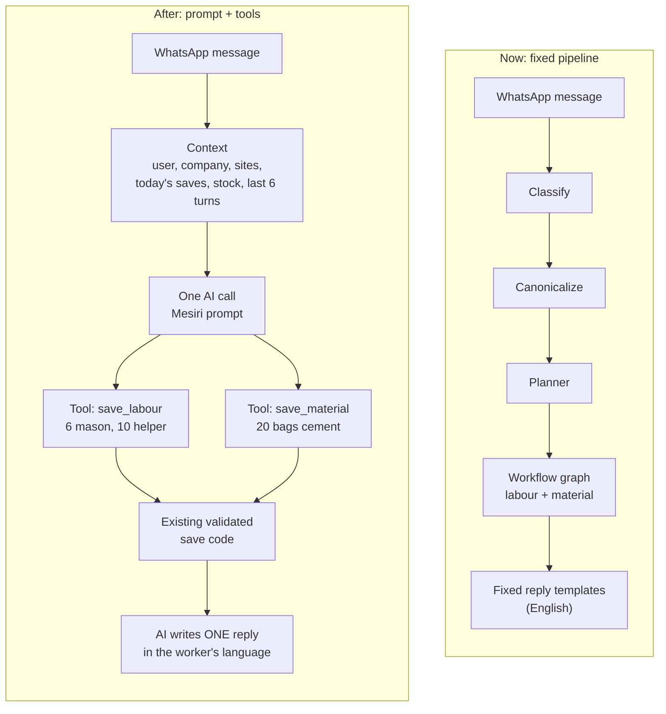

# ADR — The assistant as a tool-calling agent: wrap the workflows, don't rebuild the thinking

**Status:** Accepted for a first rollout on the test company (request [40], 2026-10-19).
Architecture OK recorded in WhatsApp (Alan, #955) and direction confirmed by Ilan (#967/#971).
**Replaces:** request [39] (more hand-built slot-filling and menus).

## Context

Free text and voice go through a hand-built chain: classify → decompose → plan → fill
slots → one of ~31 canned replies → menus. Every new situation needs another rule. The 18–19
Oct live tests showed the cost: about eight replies for one note, "which site?" with a single
site, "Green Villa" read as YES, English replies to Malayalam.

## Decision

Put an existing smart model (Gemini, function calling) in front of the workflows we already
have, and let it choose which to run. We keep every workflow, gate, validation and save path;
we drop the hand-built *thinking* in front of them for companies that switch it on.

- **One port, no second pipeline.** `platform/ai` gets a `ToolCallingProvider.run_tools(...)`
  capability (`ports/tool_calling.py`), implemented for Gemini (native function calling) and
  routed by `DynamicAIProviderResolver.run_tools` through the same config, usage reporting
  (BE-25 cost rows) and failure reporting as every other call. Route `agent` picks the model:
  standard = the environment's Gemini Flash; a premium tier is another model on that route,
  no code change.
- **Tools are thin adapters, not new logic.** Each save/query tool turns the model's arguments
  into the same understanding the classic pipeline would have produced (a `Candidate` with
  the field names the extraction prompt already documents) and runs it through the *existing*
  `process_inbound_message` — context resolution, canonicalization, material/unit/site gates,
  planner, workflow graph, save-first (`save_now`), duplicate guards. Labour and Attendance
  are therefore called exactly as before.
- **Org scoping is unchanged and server-side.** The model never sees another company or
  writes SQL. A site/project name it passes is matched only against the sender's own list
  (`ScopeLookup`) and anything else is handed to the pipeline as a name, which validates it
  against the sender's authorised records as it always has.
- **One reply.** Tool results are captured, not sent. The model writes one message from them;
  a question the pipeline needs answered (or the model's own `ask_user`) is that message's
  ending, with buttons. Follow-ups the classic path ran after a save (worker promotion,
  team-photo offer) run after the reply and only when nothing is waiting.
- **Fast paths stay.** Button taps, YES/NO, UNDO, "menu", signup, slot answers and every
  other deterministic path run before the agent exactly as today; photos/documents are not
  routed to it.
- **Switch, per company:** `assistant_mode` = `off` (default) | `agent`, platform-admin only
  (like `capture_mode`). Reading it fails closed to `off`. Migration 0485 switches on
  "Mesiri Test Builders" only.

## Limits and failure policy

At most 3 tool rounds and ~12 s per message; at most 8 tool calls; identical write calls in one
message run once. Writes make retry dangerous, so:

| Situation | Behaviour |
|---|---|
| Model/provider fails before any record was attempted | The classic outage path: "I'll process this in a few minutes" + ARQ retry (WA-18) |
| Fails after a record was attempted | Never retried. Sender gets what was saved + "please check, send anything missing again" |
| Deadline hits while a save is in flight | The save finishes (shielded) and is reported; no second model is tried after a tool ran |

## Rejected

- **More rules in the classic chain** ([39]): each fix adds states to test; the failures were
  of the "unforeseen situation" kind.
- **Letting the model call the database/SQL or the REST API directly:** loses the gates,
  validation and tenant scoping that the workflows provide.
- **A second extraction pipeline for the agent:** violates Reuse → Extension.

## Consequences / known limits

- The tools exposed are: save_labour, save_work_done, save_material_receipt/usage,
  save_expense, report_issue, transfer_money (money between accounts — the assistant has no
  material-transfer workflow), undo_last, ask_user, query_labour/materials/work_log/project/
  expenses, request_dpr.
- Receipt images ("cards") are not sent in agent mode yet; the day's records still reach the
  evening DPR.
- Today's entries and open drafts are not preloaded into the prompt: the model reads them
  through the query tools; the conversation memory (last 6 turns, pending flags) is included.
- Voice costs one speech call before the agent runs; the <4 s latency target is for text.
- Roll back: set `assistant_mode` to `off` for the company (instant), or revert the commit.

---

# Direction: one AI with a base prompt + tools (prompt + tools)

**Status:** Accepted direction, Ilan 20 Oct 2026; pilot pending.
**Builds on:** the decision above ([40]), not a parallel path. Line counts below were measured on
`main` on 21 Oct 2026 (`wc -l` over `apps/whatsapp-assistant/src`); the bot's earlier figures
came from a 19 Oct copy.

## 1. Decision

Move the WhatsApp assistant's conversation layer (understanding, deciding, reply writing) from a
fixed pipeline to ONE AI with a base prompt plus tools. The existing save/query code stays and
becomes the tools. The agent loop from [40] (`runtime/agent/`, `assistant_mode = agent`) is the
starting point: the work is to widen what it handles and then retire the classic path behind it.

## 2. Why

Today's path is classify -> canonicalize -> planner -> workflow graph -> reply templates.

- Each step drops meaning. "Nale slab concrete cheyyan pattumo?" (can we pour the slab
  tomorrow?) becomes "a note for the engineer".
- None of the steps sees today's data, so a double labour save is not noticed.
- Replies are fixed English templates, so the worker's language is lost.
- Every new case needs code + tests + a deploy.

Most of requests [33]-[67] were conversation bugs of this kind.

## 3. Target design

a. **Context** passed to the model: user, company, sites, today's saves, stock, last 6 turns,
   language. (Gap today: [40] loads the last 6 turns and pending flags; today's saves and stock
   are read through query tools, not preloaded.)
b. **One AI call** with the Mesiri voice prompt (`runtime/persona.py`, [68]/[75]/[76]).
c. **Tools** = the existing validated save/query code, scoped by organisation server-side:
   `save_labour` (with duplicate check), `save_material`, `save_work_done`, `save_expense`,
   `report_issue`, `undo_last`, `ask_user`, `query_*`, `request_dpr`.
d. **One reply**: the AI writes it from the tool results, in the worker's language.

Fast paths stay: button taps, YES/NO, UNDO, menu, signup.

## 4. Flow, now vs after

Example message: "Today 6 mason, 10 helper came. Used 20 bags cement."

## 5. The five rules

1. **The AI decides, the code saves.** Numbers never come from the AI: quantities are taken from
   the worker's message, validated by the existing save code.
2. **Evals before deleting.** A golden set including the exact expected records; a workflow moves
   only when it scores >= today's path.
3. **Switch per company.** TEST company -> one customer -> all; the old path stays as fallback.
4. **AI down -> keep the message as a note and process it later.** Never lose data (the outage
   path from WA-18 / [37] already does this for the agent; keep it).
5. **One path.** No new features in the old graph code, only urgent fixes.

## 6. What goes, what stays (estimate; measured 21 Oct)

`apps/whatsapp-assistant/src` is 57,992 lines of Python (tests: 47,114). The conversation plumbing:

| Area | Lines |
|---|---:|
| `runtime/inbound_journey/` | 7,178 |
| `runtime/message_journey.py` | 2,777 |
| `interactions/` | 2,714 |
| `workflows/` (graphs + nodes; includes the save calls that stay) | 8,356 |
| `canonicalization/` + `planner/` + `planning/` + `understanding/` | 3,505 |
| `channel/replies.py`, `runtime/reply_language.py`, `runtime/setup_questions.py` | 2,169 |

That is roughly 26k lines touching the conversation, about 20k of it pure plumbing once the save
calls inside `workflows/` are subtracted. A realistic deletion is 12-15k lines (about 21-26% of
the 58k) plus the matching tests. (The bot's 19 Oct estimate was 25-30% of ~51k; the tree has
grown since.)

**Stays:** save code, DPR/receipt PDFs, ingress, admin, auth, query services.

## 7. Costs and risks

- 1-2 AI calls per message: cost and latency, to be measured (BE-25 cost rows already record
  agent calls).
- Prompts break quietly: hence the evals (rule 2).
- Tool-calling reliability (wrong tool, missing arguments).
- Labour/Attendance tools call the existing workflows unchanged (Module Isolation): the agent
  adds no behaviour change there.

## 8. Materials pilot

- **Scope:** material receipt, usage and stock query through the agent, TEST company only.
- **Pass criteria:** 100% save accuracy on the golden set; reply quality >= today on the
  scorecard (`docs/qa/CONVERSATION_SCORECARD.md`); p50 reply time of a few seconds (measure and
  record the number here); before/after line counts recorded here.
- **Then:** roll out workflow by workflow over about 2 weeks.

## 9. Open questions

- Model tier: Flash or Pro.
- Per-message cost ceiling.
- When real companies switch (the owner decides).
- Home of the eval set: `apps/whatsapp-assistant/tests/conversation/` (already holds
  `general_messages.yaml` and `general_sequences.yaml`).

## 10. References

[40] (this ADR, above) - [68], [75], [76] (Mesiri voice, memory, polish) -
[docs/execution/VOICE_ASSISTANT_PLAN.md](../execution/VOICE_ASSISTANT_PLAN.md) -
[runtime-flow.md](runtime-flow.md) - [docs/qa/CONVERSATION_SCORECARD.md](../qa/CONVERSATION_SCORECARD.md) ([66]).
