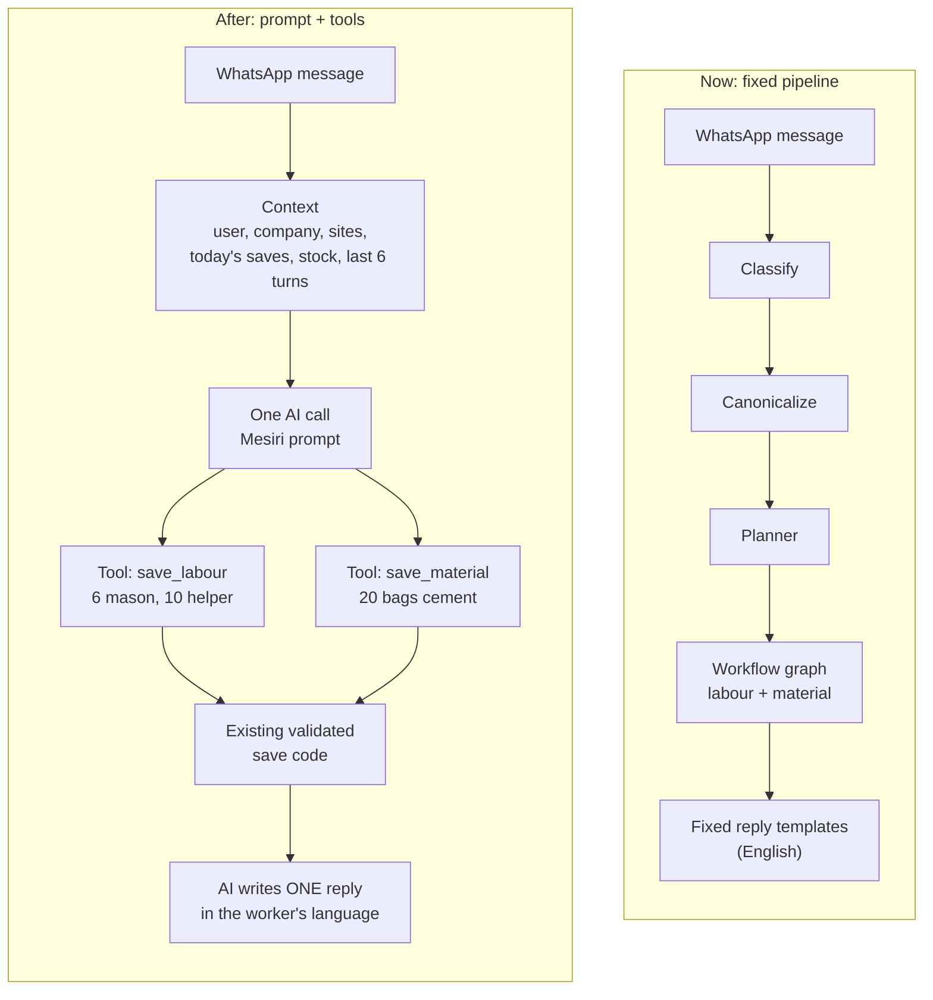

# ADR — The assistant as a tool-calling agent: wrap the workflows, don't rebuild the thinking

**Status:** Accepted for a first rollout on the test company (request [40], 2026-10-19).
Architecture OK recorded in WhatsApp (Alan, #955) and direction confirmed by Ilan (#967/#971).
**Replaces:** request [39] (more hand-built slot-filling and menus).

## Context

Free text and voice go through a hand-built chain: classify → decompose → plan → fill
slots → one of ~31 canned replies → menus. Every new situation needs another rule. The 18–19
Oct live tests showed the cost: about eight replies for one note, "which site?" with a single
site, "Green Villa" read as YES, English replies to Malayalam.

## Decision

Put an existing smart model (Gemini, function calling) in front of the workflows we already
have, and let it choose which to run. We keep every workflow, gate, validation and save path;
we drop the hand-built *thinking* in front of them for companies that switch it on.

- **One port, no second pipeline.** `platform/ai` gets a `ToolCallingProvider.run_tools(...)`
  capability (`ports/tool_calling.py`), implemented for Gemini (native function calling) and
  routed by `DynamicAIProviderResolver.run_tools` through the same config, usage reporting
  (BE-25 cost rows) and failure reporting as every other call. Route `agent` picks the model:
  standard = the environment's Gemini Flash; a premium tier is another model on that route,
  no code change.
- **Tools are thin adapters, not new logic.** Each save/query tool turns the model's arguments
  into the same understanding the classic pipeline would have produced (a `Candidate` with
  the field names the extraction prompt already documents) and runs it through the *existing*
  `process_inbound_message` — context resolution, canonicalization, material/unit/site gates,
  planner, workflow graph, save-first (`save_now`), duplicate guards. Labour and Attendance
  are therefore called exactly as before.
- **Org scoping is unchanged and server-side.** The model never sees another company or
  writes SQL. A site/project name it passes is matched only against the sender's own list
  (`ScopeLookup`) and anything else is handed to the pipeline as a name, which validates it
  against the sender's authorised records as it always has.
- **One reply.** Tool results are captured, not sent. The model writes one message from them;
  a question the pipeline needs answered (or the model's own `ask_user`) is that message's
  ending, with buttons. Follow-ups the classic path ran after a save (worker promotion,
  team-photo offer) run after the reply and only when nothing is waiting.
- **Fast paths stay.** Button taps, YES/NO, UNDO, "menu", signup, slot answers and every
  other deterministic path run before the agent exactly as today; photos/documents are not
  routed to it.
- **Switch, per company:** `assistant_mode` = `off` (default) | `agent`, platform-admin only
  (like `capture_mode`). Reading it fails closed to `off`. Migration 0485 switches on
  "Mesiri Test Builders" only.

## Limits and failure policy

At most 3 tool rounds and ~12 s per message; at most 8 tool calls; identical write calls in one
message run once. Writes make retry dangerous, so:

| Situation | Behaviour |
|---|---|
| Model/provider fails before any record was attempted | The classic outage path: "I'll process this in a few minutes" + ARQ retry (WA-18) |
| Fails after a record was attempted | Never retried. Sender gets what was saved + "please check, send anything missing again" |
| Deadline hits while a save is in flight | The save finishes (shielded) and is reported; no second model is tried after a tool ran |

## Rejected

- **More rules in the classic chain** ([39]): each fix adds states to test; the failures were
  of the "unforeseen situation" kind.
- **Letting the model call the database/SQL or the REST API directly:** loses the gates,
  validation and tenant scoping that the workflows provide.
- **A second extraction pipeline for the agent:** violates Reuse → Extension.

## Consequences / known limits

- The tools exposed are: save_labour, save_work_done, save_material_receipt/usage,
  save_expense, report_issue, transfer_money (money between accounts — the assistant has no
  material-transfer workflow), undo_last, ask_user, query_labour/materials/work_log/project/
  expenses, request_dpr, and (WA-45) set_work_site, create_site, create_project.
- **Today's site (WA-45, `runtime/agent/work_site.py`).** Where the sender works today is
  the context resolver's active context, until midnight in the company's time zone: set by
  the morning "Where are you working today?" (asked on the day's first message of anyone
  with 2+ sites except admins; that message waits and runs after the tap), by
  `set_work_site` ("now at Site B"), by every save, and by a newly created site. A site the
  message names still wins. `create_site` / `create_project` run the existing workflows
  (admin/PM, Yes/No, setup offers).
- Receipt images ("cards") are not sent in agent mode yet; the day's records still reach the
  evening DPR.
- Today's entries and open drafts are not preloaded into the prompt: the model reads them
  through the query tools; the conversation memory (last 6 turns, pending flags) is included.
- Voice costs one speech call before the agent runs; the <4 s latency target is for text.
- Roll back: set `assistant_mode` to `off` for the company (instant), or revert the commit.

---

# Direction: one AI with a base prompt + tools (prompt + tools)

**Status:** Accepted direction, Ilan 20 Oct 2026; pilot pending.
**Builds on:** the decision above ([40]), not a parallel path. Line counts below were measured on
`main` on 21 Oct 2026 (`wc -l` over `apps/whatsapp-assistant/src`); the bot's earlier figures
came from a 19 Oct copy.

## 1. Decision

Move the WhatsApp assistant's conversation layer (understanding, deciding, reply writing) from a
fixed pipeline to ONE AI with a base prompt plus tools. The existing save/query code stays and
becomes the tools. The agent loop from [40] (`runtime/agent/`, `assistant_mode = agent`) is the
starting point: the work is to widen what it handles and then retire the classic path behind it.

## 2. Why

Today's path is classify -> canonicalize -> planner -> workflow graph -> reply templates.

- Each step drops meaning. "Nale slab concrete cheyyan pattumo?" (can we pour the slab
  tomorrow?) becomes "a note for the engineer".
- None of the steps sees today's data, so a double labour save is not noticed.
- Replies are fixed English templates, so the worker's language is lost.
- Every new case needs code + tests + a deploy.

Most of requests [33]-[67] were conversation bugs of this kind.

## 3. Target design

a. **Context** passed to the model: user, company, sites, today's saves, stock, last 6 turns,
   language. (Gap today: [40] loads the last 6 turns and pending flags; today's saves and stock
   are read through query tools, not preloaded.)
b. **One AI call** with the Mesiri voice prompt (`runtime/persona.py`, [68]/[75]/[76]).
c. **Tools** = the existing validated save/query code, scoped by organisation server-side:
   `save_labour` (with duplicate check), `save_material`, `save_work_done`, `save_expense`,
   `report_issue`, `undo_last`, `ask_user`, `query_*`, `request_dpr`.
d. **One reply**: the AI writes it from the tool results, in the worker's language.

Fast paths stay: button taps, YES/NO, UNDO, menu, signup.

## 4. Flow, now vs after

Example message: "Today 6 mason, 10 helper came. Used 20 bags cement."

## 5. The five rules

1. **The AI decides, the code saves.** Numbers never come from the AI: quantities are taken from
   the worker's message, validated by the existing save code.
2. **Evals before deleting.** A golden set including the exact expected records; a workflow moves
   only when it scores >= today's path.
3. **Switch per company.** TEST company -> one customer -> all; the old path stays as fallback.
4. **AI down -> keep the message as a note and process it later.** Never lose data (the outage
   path from WA-18 / [37] already does this for the agent; keep it).
5. **One path.** No new features in the old graph code, only urgent fixes.

## 6. What goes, what stays (estimate; measured 21 Oct)

`apps/whatsapp-assistant/src` is 57,992 lines of Python (tests: 47,114). The conversation plumbing:

| Area | Lines |
|---|---:|
| `runtime/inbound_journey/` | 7,178 |
| `runtime/message_journey.py` | 2,777 |
| `interactions/` | 2,714 |
| `workflows/` (graphs + nodes; includes the save calls that stay) | 8,356 |
| `canonicalization/` + `planner/` + `planning/` + `understanding/` | 3,505 |
| `channel/replies.py`, `runtime/reply_language.py`, `runtime/setup_questions.py` | 2,169 |

That is roughly 26k lines touching the conversation, about 20k of it pure plumbing once the save
calls inside `workflows/` are subtracted. A realistic deletion is 12-15k lines (about 21-26% of
the 58k) plus the matching tests. (The bot's 19 Oct estimate was 25-30% of ~51k; the tree has
grown since.)

**Stays:** save code, DPR/receipt PDFs, ingress, admin, auth, query services.

## 7. Costs and risks

- 1-2 AI calls per message: cost and latency, to be measured (BE-25 cost rows already record
  agent calls).
- Prompts break quietly: hence the evals (rule 2).
- Tool-calling reliability (wrong tool, missing arguments).
- Labour/Attendance tools call the existing workflows unchanged (Module Isolation): the agent
  adds no behaviour change there.

## 8. Materials pilot

- **Scope:** material receipt, usage and stock query through the agent, TEST company only.
- **Pass criteria:** 100% save accuracy on the golden set; reply quality >= today on the
  scorecard (`docs/qa/CONVERSATION_SCORECARD.md`); p50 reply time of a few seconds (measure and
  record the number here); before/after line counts recorded here.
- **Then:** roll out workflow by workflow over about 2 weeks.

**Built so far (WA-36, 21 Oct):**

- Golden set: `apps/whatsapp-assistant/tests/conversation/materials_golden.yaml`, 19 messages
  (English, Manglish, Malayalam script, Hindi): receipts, usage, mixed with labour, two
  materials in one message, unclear ones that must get one question, and stock questions that
  must save nothing. Each lists the exact records expected.
- CI checks the save half on every push: the ideal tool calls go through the real journey and
  must file exactly those records (`test_materials_golden.py`).
- The live measurement is `pytest -m live tests/conversation/test_materials_golden.py` with
  `GEMINI_API_KEY` set; it prints each case, the accuracy and the p50 time. **First run 22
  Oct:** 18/24, then 22/24 (p50 1.3 s) after the prompt fixes; per-run table in section 10b.
  Runs on demand as the claude-ops task `golden-live`.
- The agent now gets the sender's site stock in its context ("Stock now at <site> (from the
  records): ..."), read-only, one-site senders only, 300 ms limit, left out on any failure.
- Still to do: the live run and its numbers; reply quality on the scorecard; before/after line
  counts; then retire the material graphs.

## 9. Open questions

- Model tier: Flash or Pro.
- Per-message cost ceiling.
- When real companies switch (the owner decides).
- Home of the eval set: `apps/whatsapp-assistant/tests/conversation/` (already holds
  `general_messages.yaml` and `general_sequences.yaml`).

## 10. The save rule (Ilan, 21 Oct 2026)

The AI gets wide freedom to understand, decide and talk. The one hard rule is about data:
**nothing a worker sends is kept until they tap Save on a confirmation.** Built as WA-35:

- The agent saves through the existing save-first path (WA-01), so every record is a
  **draft** the moment it is written. Its reply lists those drafts under "📝 To save:"; the
  list is written by code from the saved data, never by the model.
- The reply carries **✅ Save** and **❌ Cancel** (in place of Undo). Save confirms exactly
  the drafts on that card (BE-09 confirm, as the evening "Keep it" does); Cancel rejects
  them through each module's own undo (BE-09 reject, as "Remove it" / UNDO do). Typing
  "save" or "cancel" works like the tap.
- The tap carries the record ids (`agt:<save|cancel>:<type><uuid>...`), so no state is
  kept between reply and tap. Only the tapper's own drafts, in their own company, and only
  while still drafts, are settled.
- A draft nobody taps stays a draft and comes up in the evening review (WA-05): nothing is
  lost, and nothing unchecked reaches the DPR.
- Applies to every company on `assistant_mode = agent` (today: Mesiri Test Builders only).
  The classic path is unchanged (save-first + evening confirmation).
- **Not covered yet:** a reply whose saves include something the review log does not track
  (a progress update), more than 7 records, or a reply that ends on a question keeps the
  old behaviour (Undo / evening review). A team-photo offer that was held back still says
  "Attendance recorded" when it is sent on its own.
- Rollback: revert the WA-35 commit, or set the company's `assistant_mode` to `off`.

### 10a. The AI writes the reply (WA-37, after the 21 Oct live test)

The live test ([docs/qa/runs/2026-10-21-WA-35-36](../qa/runs/2026-10-21-WA-35-36/REPORT.md))
showed replies that were still templates: the model was told to stay silent after a save,
a B-7 speed-up skipped its second round for plain-letter messages (all Manglish), and the
old pipeline still split tool calls and answered with its own plan summary. Changed:

- **The model writes every reply** (the B-7 skip is gone): what it understood, in the
  worker's language and letters, then "check and tap Save". Under its words, one short
  code-built line of what will be saved (kept as backup protection), with Save / Cancel.
- **Numbers are checked, not trusted.** Every figure in the model's text must appear in the
  message, its prompt (stock, today), a tool result or a tool argument; otherwise its words
  are dropped and the system line stands (logged as `agent.number_guard`).
- **Questions get answers.** Stock and quantity questions are answered from the stock line or
  the query tools; only a question needing a person's decision is passed to the engineer,
  shown as "📨 Question for your engineer: ..." and never as an entry to save.
- **The old pipeline stays quiet under the agent:** one canonical event per tool call (no
  cross-module second step, no "Here's what I did ... which site?"), and a refused or failed
  save is reported as not saved, never "Saved".
- Receipts show the supplier, usage the work it was for; "50 bags cement" is asked
  received-or-used; an English message gets English.
- Cost: every entry now takes the model's second round (about 1-2 s more). Measure it with
  the live golden run.

**Round 2 (WA-38, 21 Oct afternoon):**

- **A question goes to the engineer only when the sender asks for that** (Ilan, 21 Oct):
  "engineer-inodu chodikku", "ask the engineer", or "yes" to the AI's own offer to ask.
  Enforced in the toolbox; any other question is answered from the records, or the AI says
  plainly the records can't answer it and offers to ask.
- **Reply letters follow THIS message**, stated to the model as a fact computed in code;
  the sender's earlier language only counts for a message with no letters ("👍").
- **Code checks on the model's words:** sentences claiming an entry is saved/recorded before
  the Save tap are dropped (English, Manglish, Malayalam, Hindi); a code word ("clientIdb")
  drops its words; numbers as before.
- A question passed on gets no receipt card and no "tap Save"; its line is said once.
- A shortage message ("10 bag balance und, kooduthal venam") is a material-shortage issue,
  with both figures when the stock disagrees.

**Round 3 (WA-43, BE-45, 21 Oct evening;
[docs/qa/runs/2026-10-21-round-3](../qa/runs/2026-10-21-round-3/README.md)):** 12 of 15 passed;
the role tests could not run (the bot's number is an admin).

- The saved-claim check drops only the claiming clause, so "… vannu, save cheythu." keeps
  "… vannu." (a whole-sentence drop had left one Save card with no AI words).
- Manglish is recognised in code from everyday words and stated to the model ("reply in
  Manglish"); "English letters" alone got English answers.
- Stock received/used net out corrections (a Cancel posts the opposite movement), so
  received − used = stock.

## 10b. Official: retire the old pipeline (Ilan, 21 Oct 2026)

Three live rounds on 21 Oct showed the agent is better in conversation, and that running it
*on top of* the old pipeline is now the main source of bugs (the old splitter making a second
entry, its "Which site?" and summaries leaking, a lookup counted as a save, its buttons saving
without the Save card). The wrap was the bridge; it is not the end state. Decided:

- **The agent is the assistant.** The classic pipeline (classify -> canonicalize -> decompose ->
  planner -> workflow graph -> reply templates) gets no new features (rule 5) and is removed
  area by area.
- **Tools call the services directly.** A tool resolves its scope (`ScopeLookup`), resolves names
  against the company's records (catalog, sites, workers), applies the gates as plain checks
  (unit conversion, duplicate, closed day, permissions), builds the `DraftActionV2` and hands it
  to save-first. No `process_inbound_message`, no planner, no graph, no captured replies. This
  replaces the "tools run through `process_inbound_message`" bullet of [40] above.
- **Unchanged:** the Save rule (section 10), the number check, server-side org scoping, the
  save code and its validation, DPR/receipts, fast paths (taps, UNDO).
- **Order and gates** (tracker `ARCH-*`): each area moves only when its golden set passes on
  the real model; Labour moves only with Alan's approval (Module Isolation); real companies
  switch one at a time when the owner decides (rule 3).

| Step | What | Gate |
|---|---|---|
| ARCH-01 | Material receipt/usage tools call a material entry service directly | materials golden set green in CI, unchanged |
| ARCH-02 | Golden sets for work done, site issues, expenses; then their tools go direct | each set green, live run recorded. **Done 22 Oct:** `runtime/agent/site_entry.py` on the shared `entry_base.py`; live site set 18/18 twice (table below) |
| ARCH-03 | Labour tool direct | Alan's approval; labour golden set. **Done 22 Oct** (`823719e`, Alan's approval relayed by Ilan): `runtime/agent/labour_entry.py`; 6 labour cases in the site set, 6/6 live |
| ARCH-04 | Agent-mode taps: the old gate buttons replaced by `ask_user` answers, so nothing saves past the Save card | replay tests |
| ARCH-05 | First real company on the agent, then all | owner decides; live golden runs >= 100% on materials |
| ARCH-05 done | **Every company on the agent** (Ilan, 21 Oct, `1132e9f`): `assistant_mode` defaults to "agent"; "off" is the per-company fallback | owner's decision, before the live golden runs |
| ARCH-06 | Delete the classic path per area (understanding, planner, decomposition, graphs, templates); record line counts | ~~area switched everywhere for 1 week~~ Ilan, 22 Oct: now, in steps behind the live runs. **Done 22 Oct.** Step 1 `dcef4dc` (no classic fallback); step 2 `ac43bee` (lookups, transfers, site/project create, money undo: `runtime/agent/query_entry.py`); step 3 `5bf7a72` (photos and bills read by the vision model, then the agent), `275849d` (`process_inbound_message` and everything only it reached deleted: 11.7k lines; the control panel's test message runs the real handler), `34ac2be` (planner, gates, dead seeds: 2.3k lines; lookups as a PDF restored). See "After ARCH-06" below |

**Live runs, 22 Oct** (`gemini-2.5-flash`, claude-ops task `golden-live`, GitHub Actions with
TEAMMATE_GEMINI_API_KEY, approved by Ilan 22 Oct). Accuracy = exact records saved (or the one
question asked) per case; p50 = reply time.

| Commit | What changed | Site set (18) | Materials set (24) |
|---|---|---|---|
| `525e4ce` | baseline: work/issues/expenses on the classic route | 12/18 (67%), p50 1.3 s | not run |
| `463530e` | ARCH-02 direct routes; work type taken from its quantities | 16/18 (1 Gemini timeout) | 18/24 |
| `fd2f946` | arrival words mean "received"; units go to the save tool | 17/18 | 22/24 |
| `779fbf9` | singular/plural material names match; a question is an ask_user call | 17/18 | 22/24 |
| `d185d63` | units in English; no example numbers in a question | **18/18**, p50 1.5 s | 22/24 |
| `4ceb228` | the number guard drops only the sentence with a made-up figure | **18/18**, p50 1.3 s | 22/24, p50 1.3 s |

From `823719e` the site set has 24 cases (6 labour).

| Commit | What changed | Site set (24) | Materials set (24) |
|---|---|---|---|
| `823719e` | ARCH-03 labour direct | 23/24 (#19 a Gemini timeout), labour 5/5 answered | 23/24 |
| `ac43bee` | ARCH-06 step 2: lookups etc. direct | 22/24 (labour 6/6; #8 Malayalam script in a Manglish reply, #16 question as plain text), p50 1.4 s | 23/24 (stock questions 4/4), p50 1.4 s |
| `275849d` | ARCH-06 step 3: classic pipeline deleted | **24/24**, p50 1.3 s | **24/24**, p50 1.1 s |

From `0c72b3e` a third set: photos and bills (10 cases, `photo_golden.yaml`), as the agent reads them.

| Commit | What changed | Site (24) | Materials (24) | Photos (10) |
|---|---|---|---|---|
| `0c72b3e` | leftovers 1-5 (old code gone, photo set) | 23/24 (#16 question as plain text) | 24/24 | 6/10 (bill trade names; a PDF saved, the set was too strict) |
| `cb045f4` | plain material names asked for; a plain-text question waits | **24/24** | **24/24** | 7/10 (trade names) |
| `54621e6` | a bill's trade name finds the one listed material it names | - | - | **10/10** |

Left on materials (ARCH-01, live since 21 Oct), neither saves anything wrong: "50 bags cement
arrived" sometimes still gets one "Received or used?" tap (2 of the last 4 runs), and "cement
vannu" gets the right question as plain text rather than an ask_user call (no buttons, the
answer still comes back as a new message).

**After ARCH-06 (22 Oct).** Every message (text, voice, a photo after its purpose tap, a
document) goes to the agent; its tools start the workflows through the direct entries
(`runtime/agent/{material,site,labour,query}_entry.py` on `entry_base.py`). What is left
of `runtime/inbound_journey` is the seed functions the entries call (`seeding.py`), the
workflow-run reply rendering (`reply.py`) and `_shared.py`. Taps that answer a workflow
(Yes/No, Save/Cancel, slot answers, evening review, work site) never went through the
pipeline and are unchanged.

- `assistant_mode` "off" no longer routes anywhere (there is no classic pipeline to fall
  back to); the stored setting is left as it is (no migration).
- Not reachable since every company moved to the agent (ARCH-05, 21 Oct), and now gone
  with the code: the multi-message plan preview (the agent makes one tool call per
  entry), adding a member by typed name (contact cards still do it), and the WhatsApp
  starts of activity correction, site-issue close and automation setup. Any of these
  that is wanted back becomes an agent tool on an entry.
- The 13 classic replay cases went with their harness; the agent replay and the two
  golden sets (site 24, materials 24) are the regression net.

## 11. References

[40] (this ADR, above) - [68], [75], [76] (Mesiri voice, memory, polish) -
[docs/execution/VOICE_ASSISTANT_PLAN.md](../execution/VOICE_ASSISTANT_PLAN.md) -
[runtime-flow.md](runtime-flow.md) - [docs/qa/CONVERSATION_SCORECARD.md](../qa/CONVERSATION_SCORECARD.md) ([66]).
