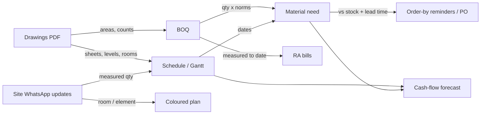

# Connected project: drawings → BOQ → schedule → materials → progress (Nov 2026)

> **Status:** ideas turned into a plan, 8 Nov 2026 (asked in session: "ideate what all can be done, like material plan
> from BOQ + schedule, drawings and all connecting, or progress updating automatically … put all of these in the
> plan"). Tracker section **CP** in [V1_TRACKER.md](V1_TRACKER.md). Nothing here is built yet.
>
> Builds on, and does not duplicate: [project-start-plan.md](project-start-plan.md) (ST: BOQ import, Gantt),
> [project-documents-plan.md](project-documents-plan.md) (DOC: the documents register),
> [cost-control-plan.md](cost-control-plan.md) (CC: BOQ, material norms, reconciliation),
> [procurement-plan.md](procurement-plan.md) (PRC: stock, POs) and
> [drawings-to-progress-plan.md](drawings-to-progress-plan.md) (DRW, **V2**: structural drawings → elements →
> progress). Where an idea is already one of those items, section 5 says so and only a note is added there.

---

## 1. The idea in one line

Everything a project already has (the drawings, the BOQ, the schedule, the stock, the site's daily WhatsApp messages)
is connected, so each one fills in the others and **nobody types anything twice**:

## 2. Worked example: the Kondotty commercial set

Kaleido Architects, "COMMERCIAL @ KONDOTTY", client Mr. Abdullakutty, 9 A4 sheets dated 18.05.2026 (basement, ground
and first floor plans; front, back, back-side and left elevations; sections A-A and B-B). CAD-exported, so **every
title block, room name, size and level is real text** (`pdftotext`), not something an AI has to guess.

| Read from the PDF (no AI) | Used for |
|---|---|
| 9 sheet titles, scale 1:100, date, architect, client, "all dimensions in cm" | Splitting the set into a register automatically (CP-05) |
| Levels: −265 (basement), ±0 / +45 (ground), +400 / +450 (first), +805 / +855, +1167.5, +1270 (top) | Floors and floor-to-floor height (≈ 405 cm) → schedule per floor (CP-09); "what is the first floor slab level?" (CP-07) |
| Rooms: ROOM-1 1740 × 590, ROOM-2 and ROOM-3 1740 × 650, on ground and first floors; lift 180 × 240; fire stair; prayer room 150 × 300 | Room areas → flooring, plaster, paint (CP-08); rooms as places to report progress against (CP-10); lettable area (CP-15) |
| Toilets 12 (basement 4, ground 4, first 4), urinals 6 (basement 3, first 3), passages 133 and 210 cm, ramp | Sanitary fixture counts for the BOQ (CP-08) |
| Note on section: "slab sinking 30 cm" (toilets) | A check item before the slab pour |

**A mistake found by reading it:** ROOM-1 is drawn 1740 × 590 cm but labelled **1217 sq ft**. 17.40 × 5.90 m =
102.7 m² = **1,105 sq ft**; 1,217 sq ft is ROOM-2's area (1740 × 650), so the label was copied. This is what CP-06
catches on upload, before the drawing reaches site. It is also the best client demo in this plan.

This set is architectural. The structural set for the same job (De Framez, 15 pages: footings, columns, slab tables) is
the one the DRW plan was proven on (23 footings counted exactly from the text layer).

## 3. What each role gets

| Role | Gets |
|---|---|
| Site engineer | The current drawing and the level / size they need, in one WhatsApp message; reports progress by room ("Room-2 plastering done") |
| Project manager | A schedule made from the drawings in minutes; order-by reminders before material runs out; a revision that clashes with work already done is flagged |
| Owner / MD | The coloured plan every evening; cash needed next month; lettable area of what is being built |
| QS / estimator | A draft BOQ from the drawings, or a check of theirs ("BOQ flooring 1,800 m², drawings 2,150 m²") |
| Storekeeper / purchase | "Order 380 bags by Thursday" with the PO already drafted |

## 4. Investigation (Phase 1, `main` at `29ca193`)

| Area | Exists | Reuse |
|---|---|---|
| BOQ | `work_package_planned_items` with unit, rates, cost centre (0508, CC-02); Excel import (ST-03) | Material plan reads BOQ lines; a draft BOQ (CP-08) goes through the ST-03 preview/import |
| Schedule | `work_packages.planned_start/end`, "starts after", forecast finish, quick plan (ST-04, 0522) | Dates spread the material need over weeks (CP-01); a per-floor template feeds quick plan (CP-09) |
| Material norms | **Not built:** CC-03 `boq_material_norms` (1 m³ M20 → cement bags, M-sand, metal; wastage %) | CP-01 needs CC-03; it does not make its own norm table |
| Required vs on hand | **Not built:** CC-08 (BOQ × norm vs received vs consumed vs on hand, shortage forecast) | CP-01 is CC-08's shortage forecast **with dates**: build it as part of the same read model, not a second one |
| Stock and POs | Stock summary and running low (PRC-17), POs with PDF on WhatsApp (PRC-26), "what to get tomorrow" (WA-102) | Order-by compares with stock + open POs; one tap drafts a PO |
| Lead time | Nothing stored | New nullable `vendors.lead_time_days` + per-material override (additive, CP-02) |
| Reminders | One reminder pass (`application/procurement/alerts.queue_reminders`), schedule notes (ST-06) | Order-by note is one more note in the same pass |
| Documents | Planned only (DOC-01, blocked on D-DOC1) | CP-05..07 hang off the register; they do not create their own file store |
| Drawing reading | Planned only (DRW-03, V2): text layer first, vision to classify/check, a person confirms | CP-05..08 are the **architectural, text-layer-only** first slice of the same extraction; one pipeline, one facts table that DRW-03 extends |
| Locations | `location_nodes` proposed by DRW-04 | Rooms are location nodes too (CP-10); no second location model |
| Plan images | Playwright renderer (DPR PDF, receipts) | Coloured plan image (DRW-07) |
| Assistant | v3: API route + `agent_api/tools.py` `ALLOWED` + SOP rule | Every WhatsApp feature here is a route + `ALLOWED` line, never a workflow or word list |

## 5. The ideas, mapped to work

### A. Material plan (no drawings, no AI) — build first

| ID | What | Notes |
|---|---|---|
| CP-01 | **Time-phased material plan:** BOQ line remaining qty × norm (CC-03) spread over its schedule activity's dates → need per material per week per site; minus on hand and on order → shortfall week. `GET /projects/{id}/material-plan?weeks=8`; Planning › Material plan page (materials × weeks grid, red where short) | Part of the CC-08 read model. Remaining qty = planned − measured (CC-04), so the plan updates itself from site messages |
| CP-02 | **Order-by reminders:** shortfall date − lead time = order-by date. Note to PM / storekeeper in the reminder pass: *"First floor slab on 20 Nov needs 380 bags cement and 4.2 t steel. Stock covers 150 bags. Order by 14 Nov."* with a button that drafts the PO (PRC) | `vendors.lead_time_days`, material override; default 3 days (D-CP2) |
| CP-03 | **On WhatsApp:** "what do I need next week?", "cement for the first floor slab?" → v3 `material_plan` read tool + SOP rule | Route in `ALLOWED` |
| CP-04 | **Cash-flow forecast:** material plan × rates + labour (BOQ labour rate over the schedule) + subcontract out; RA bills (NXT-02) in → month by month | Money: who sees it is D-CP3 (needs Ilan) |

### B. Drawings, read from the text layer (after DOC-01)

| ID | What | Notes |
|---|---|---|
| CP-05 | **Set auto-split:** one uploaded PDF → one register entry per sheet with title, number, scale, date, architect, discipline, level, read from each page's title block (DOC-01 reads page 1 only) | Text layer; vision only to classify a page with no text, flagged |
| CP-06 | **Drawing checks on upload:** area label vs its dimensions (the ROOM-1 case), the same level differing between sections and elevations, missing scale / date / revision, same room size differing between floors that look typical. Shown to the uploader and PM as "2 things to ask the architect" | Never sent to the architect automatically (D-CP4). Every flag shows page + position |
| CP-07 | **Drawing facts on WhatsApp:** "first floor slab level?" → "+400 (finish +450), section A-A"; "Room-2 size?" → "1740 × 650 cm, 1,217 sq ft, ground floor plan". `drawing_facts` (sheet, kind, label, value, page position, confirmed) | The table DRW-03 extends with structural elements; one facts table, not two |
| CP-08 | **Draft BOQ / BOQ check from drawings:** room areas, wall lengths (vector lines), heights from sections → flooring, skirting, plaster, paint, brickwork, doors / windows, sanitary fixtures. Either a draft BOQ through the ST-03 preview, or a diff against the existing BOQ | Every number from geometry or a formula, never a model's guess; a person confirms. Needs the DRW-01 golden set to measure accuracy |
| CP-09 | **Schedule from levels:** floors from the sections → per-floor template (footing → columns → slab → brickwork → plaster → finish), "starts after" filled, into ST-04 quick plan | Company can edit the template |

### C. Progress that updates itself

| ID | What | Notes |
|---|---|---|
| CP-10 | **Rooms as places:** rooms from the plans become `location_nodes` (Building → Level → Room); "Room-2 plastering 60%" or "first floor toilets tiled" is recorded against the room; the plan is coloured by room | DRW-04/05 do structural elements; rooms are the architectural side of the same model. Coloured view and owner card are DRW-06/07 |
| CP-11 | **"What's left on the first floor?"** on WhatsApp, answered room by room | v3 read tool over CP-10 |
| — | Photo pinned to its room / grid on the plan, photo history per room | **= DRW-05** (note added there: rooms too) |
| — | Progress → Gantt bars → RA bill quantities | **Exists / planned:** CC-04 + ST-04 measure bars from site work; NXT-02 bills measured quantities. Nothing new |
| — | Revision alert: "first floor plan changed, old printouts out of date" | **= DOC-02**; the "what changed" text is DRW-11 |
| CP-12 | **Rework catcher:** a new revision (DRW-11 diff) that moves something already reported done on site (CP-10 / DRW-05) is flagged to PM before more work is built on it: "Rev B moves the first floor toilet; Room-2 toilet is already tiled per rev A" | Extends DRW-11 with progress |
| — | Handover pack with approved drawings + progress photos per room | **= DOC-07** (note added there) |

### D. Later

| ID | What | Notes |
|---|---|---|
| CP-13 | **Simple 3D shell:** walls extruded to the floor heights, coloured by progress; whole-building view | Only after CP-10 works on real projects |
| CP-14 | **Lettable / saleable area summary** for owners of commercial or apartment jobs, from room areas | Small; good for sales demos |

## 6. Implementation plan (Phase 2, per CLAUDE.md)

**Objective.** The data a project already has fills in the rest: the material plan and order-by dates come from the BOQ
and schedule; drawings fill the register, the schedule and the BOQ check; site messages colour the plan.

**Scope, first round:** CC-03 → CP-01 → CP-02 → CP-03 (the material plan). **Second:** CP-05 → CP-06 → CP-07 once
DOC-01 is unblocked. **Third:** CP-09, CP-08, then CP-10..12 with DRW (V2). CP-04 when D-CP3 is decided. CP-13/14 later.

**Business value.** "What do I need to order, and by when?" is asked every week on every site, and a late cement or
steel order stops a pour. The drawing checks and the coloured plan are what a client remembers from a demo.

**Files expected to change (first round).** `backend/src/mesiri/domains/materials/` (material plan read model with
CC-08), `domains/procurement` reminder pass (order-by note), one additive migration (`vendors.lead_time_days`,
`materials.lead_time_days`), `apps/whatsapp-assistant/.../agent_api/tools.py` `ALLOWED` + `SOP.md` rule,
`apps/dashboard/src/` Planning › Material plan page. Tests next to each.

**Database.** First round: two nullable columns (additive). Second round: `drawing_facts` (additive, RLS like 0522).
Third: rooms in `location_nodes` (DRW-04's table). No data rewritten.

**API.** `GET /projects/{id}/material-plan`; `GET /projects/{id}/drawing-facts?q=`; `POST /documents/{id}/split`
(inside DOC-01's upload); later room progress routes with DRW-05.

**Risks.**
- Norms are only as good as the company's numbers: defaults must be clearly marked "standard" and editable (CC-03).
- Schedules that nobody keeps up make the plan wrong: the plan shows which activity each need comes from, so a wrong
  date is visible; ST-04 already forecasts from the site's pace.
- Drawing sets differ by office (title blocks, units cm / mm): CP-05..08 need the DRW-01 golden set (10 customer sets)
  before they are trusted; nothing from a drawing is used until a person confirms it.
- Reminder fatigue: one order-by note per day, grouped, only for shortfalls inside the lead time.

**Testing.** Unit tests for the phasing maths (spread, remaining, lead time), route tests with a seeded BOQ + schedule +
stock, the v3 tool contract test, dashboard `tsc` / oxlint / build; for drawings, the Kondotty sets as fixtures with
expected sheets, levels, rooms and the ROOM-1 flag.

**Rollback.** Each item is its own commit; reverting it removes the route, page and note. The columns are nullable and
unused by anything else; the downgrade drops them. The reminder note is behind the existing reminder settings.

**Labour isolation.** First round reads no Labour or Attendance data. CP-04 reads labour rates from the BOQ only
(attendance cost stays CC-05/CC-07). Payroll and Workforce are not touched by any CP item.

**Success criteria.** On a test project with a BOQ, norms and a schedule, the material plan shows the right weekly
need and the order-by note arrives on the right day; on the Kondotty set, upload gives 9 named sheets, the levels and
room sizes answer on WhatsApp, and the ROOM-1 label is flagged.

## 7. Decisions (defaults used until answered)

| # | Question | Proposed default |
|---|---|---|
| D-CP1 | Where norms come from | Standard defaults per item type (CC-03), editable per company and per project |
| D-CP2 | Lead time | Per supplier, override per material; 3 days when unknown |
| D-CP3 | Who sees the cash-flow forecast | Owner, admin, finance (`may_view_expenses`). *Permissions: needs Ilan* |
| D-CP4 | Drawing check results | Shown to the uploader and PM only; never sent to the architect by Mesiri |
| D-CP5 | Drawing → BOQ / schedule | Always a draft through preview; never overwrites a BOQ or schedule someone made |
