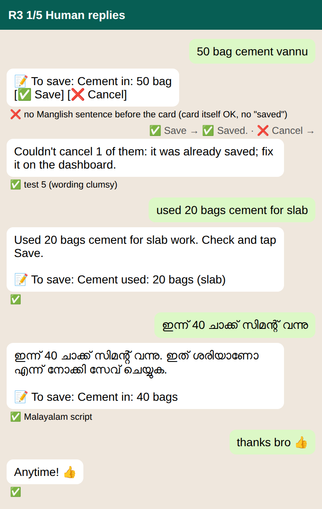
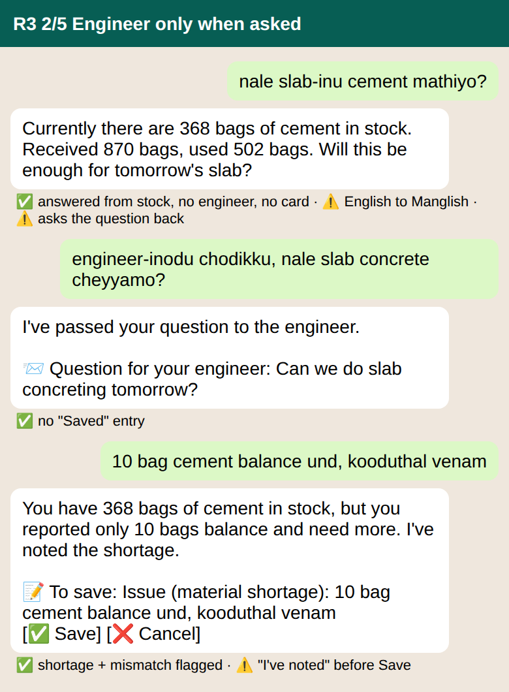
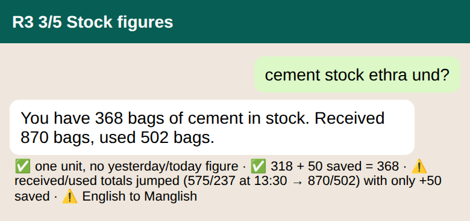
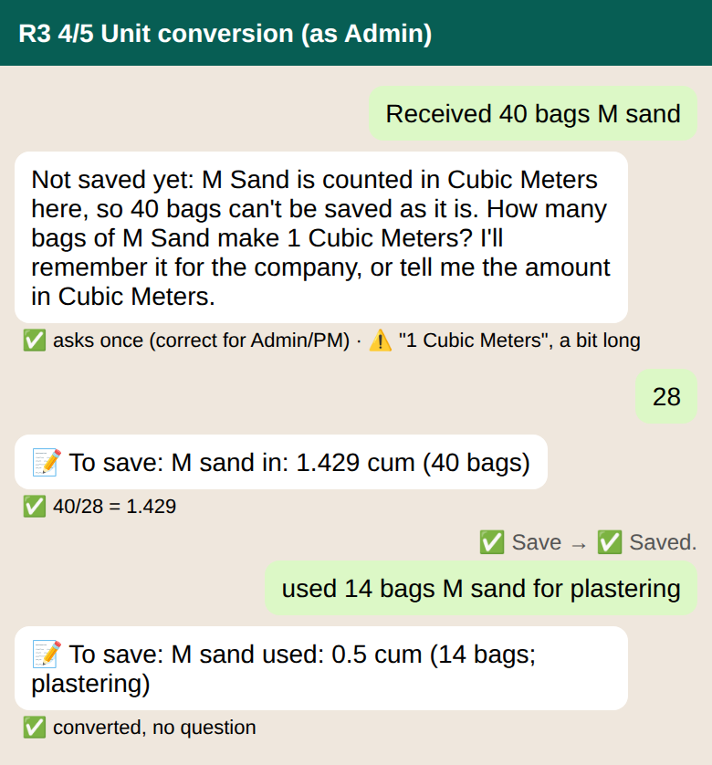
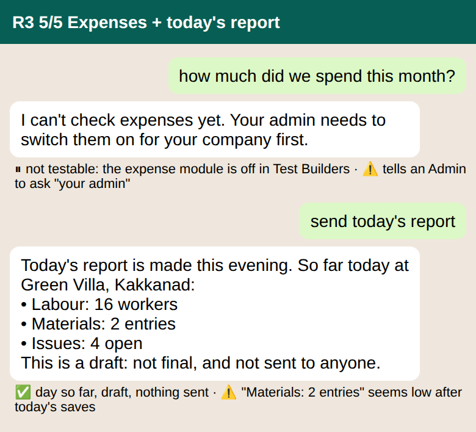

# WhatsApp test, round 3 (21 Oct 2026)

Company **Mesiri Test Builders**, site **Green Villa**, agent mode. Build on `main` with WA-37..42 and SEC-01 (the deploy run could not be verified from the bot). 21 sends through `test_assistant`; the screenshots are redrawn from the real replies. Temporary evidence, like round 2.

**Important limit:** the bot's test number is role **Admin** (checked with "who am I"), not site engineer or PM. Every test ran as Admin, so the role-split tests (10 vs 11, 13 vs 14) were not possible.
Reply times were not measured (`test_assistant` gives no timing); every reply came within the ~90 s window.

## Results

| # | Message | Result | What happened |
|---|---|---|---|
| 1 | "50 bag cement vannu" | **PARTIAL FAIL** | Only "📝 To save: Cement in: 50 bag" with Save / Cancel. No Manglish sentence before the card. No "saved" wording (that part passes). |
| 2 | "used 20 bags cement for slab" | PASS | "Used 20 bags cement for slab work. Check and tap Save." and "Cement used: 20 bags (slab)". |
| 3 | Malayalam: 40 bags cement came | PASS | Malayalam-script reply and card "Cement in: 40 bags". |
| 4 | "thanks bro 👍" | PASS | "Anytime! 👍" |
| 5 | Cancel after Save | PASS | "Couldn't cancel 1 of them: it was already saved; fix it on the dashboard." (wording is clumsy) |
| 6 | "nale slab-inu cement mathiyo?" | PASS (notes) | "Currently there are 368 bags of cement in stock. Received 870 bags, used 502 bags. Will this be enough for tomorrow's slab?" No engineer, no card. Note: English reply to Manglish; it throws the question back. |
| 7 | "engineer-inodu chodikku, nale slab concrete cheyyamo?" | PASS | "I've passed your question to the engineer. 📨 Question for your engineer: Can we do slab concreting tomorrow?" Not shown as Saved. |
| 8 | "10 bag cement balance und, kooduthal venam" | PASS | Shortage card, flags 10 vs 368. Warn: says "I've noted the shortage" before Save. |
| 9 | "cement stock ethra und?" | PASS | One unit, no yesterday/today figure: "You have 368 bags of cement in stock. Received 870 bags, used 502 bags." Warn: received/used were 575/237 at ~13:30 and are 870/502 now with only +50 saved in between (stock 318 → 368 is consistent). Check the totals query. |
| 10/11 | "Received 40 bags M sand" (as Admin) | PASS | Asks once how many bags make 1 cum ("1 Cubic Meters" grammar, long). "28" → "M sand in: 1.429 cum (40 bags)"; saved. Engineer behaviour (no ratio question) not testable. |
| 12 | "used 14 bags M sand for plastering" | PASS | "M sand used: 0.5 cum (14 bags; plastering)", no question (cancelled). |
| 13/14 | "how much did we spend this month?" | **NOT TESTABLE** | "I can't check expenses yet. Your admin needs to switch them on for your company first." The expense module is off in Test Builders; odd to tell an Admin "your admin". |
| 15 | "send today's report" | PASS | Day so far (Labour 16, Materials 2 entries, Issues 4 open), "draft: not final, and not sent to anyone". Warn: "Materials: 2 entries" looks low after today's saves. |

No leaked code words this round. No wrong script except English replies to Manglish (6, 9).

## Screenshots

1. A. Human replies (tests 1-5): 
2. B. Engineer only when asked (tests 6-8): 
3. C. Stock figures (test 9): 
4. D. Unit conversion (tests 10-12, run as Admin): 
5. E. Expenses + F. Today's report (tests 13-15): 

## Open

- Test 1: add the short Manglish sentence before the card.
- Check the received/used totals query (jump 575/237 → 870/502 with +50 saved).
- Check "Materials: 2 entries" in the day-so-far report.
- Wording: the Cancel-after-Save refusal; "I've noted the shortage" before Save; "your admin" shown to an Admin; English replies to Manglish (6, 9).

## To unblock the role tests

Register two more test numbers (site engineer, PM) in Test Builders, or change the bot number's role, and switch the expense module on in Test Builders.

## Test data left behind

Cement in 50 bags; M sand in 1.429 cum; ratio 28 bags/cum stored for the company.

## Not verified

Deploy run of WA-37..42 / SEC-01; reply times; every role-based expectation (10 vs 11, 13 vs 14).
