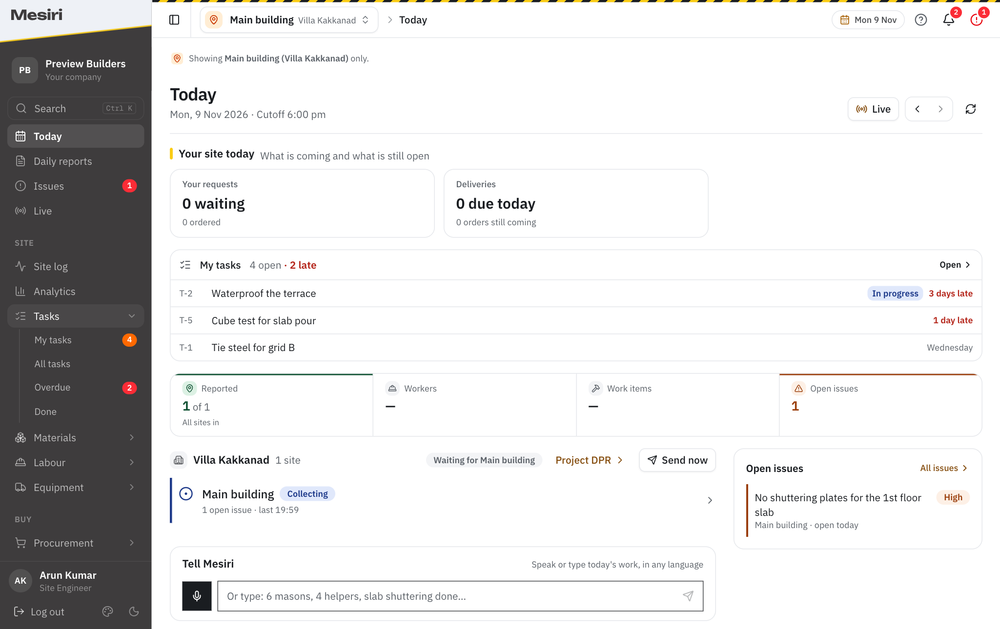
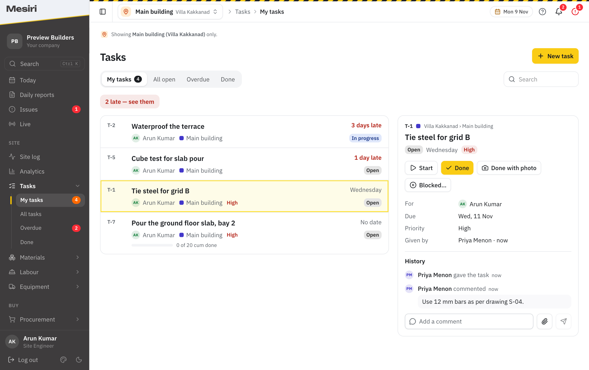
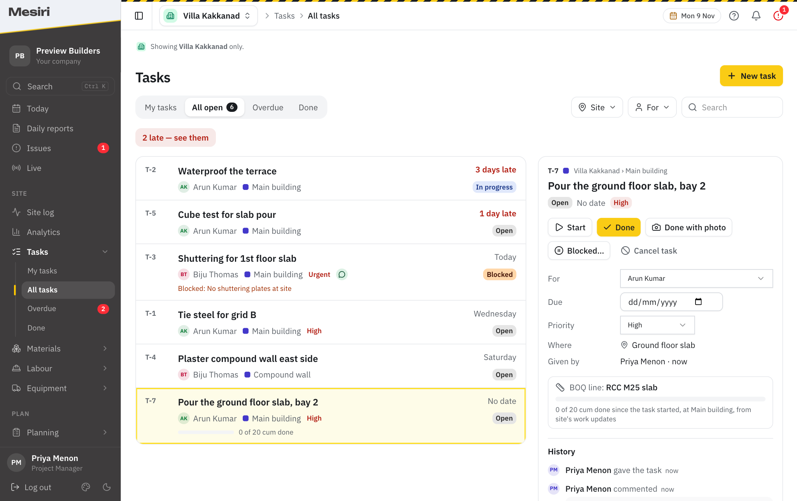
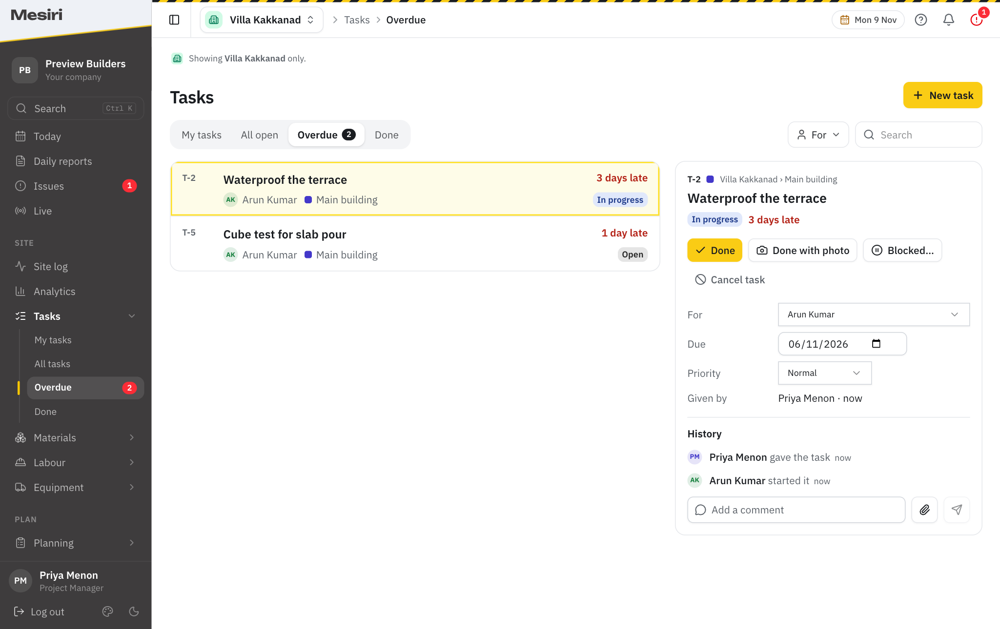
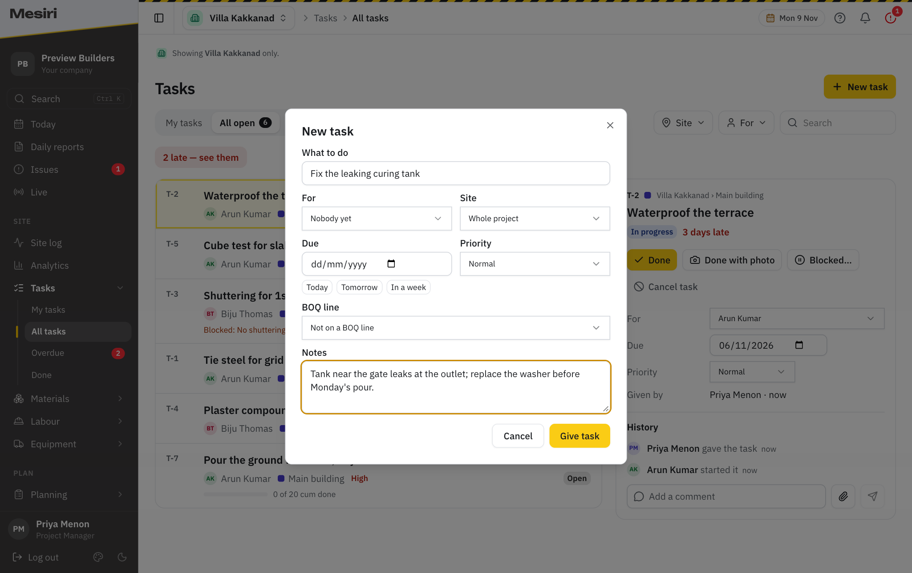
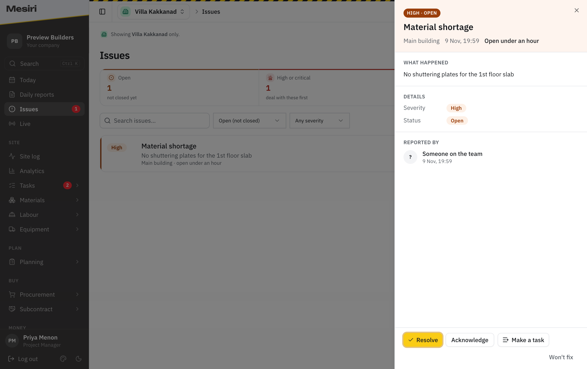
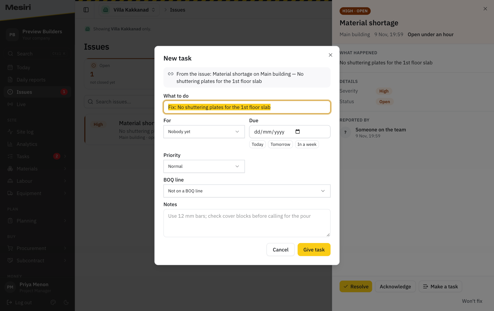

# Mesiri Tasks: walkthrough for the team

> TSK-07, 9 Nov 2026. For whoever sets a company up on Tasks, and for that company's project manager.
> **Tasks is web only for now** (Adarsh, 9 Nov 2026). Giving, closing and chasing a task over WhatsApp is designed
> but not built (TSK-04, TSK-05), so **do not promise WhatsApp to a customer yet**.
> Screenshots are the real dashboard on demo data (`images/`). Plan: [tasks-plan.md](../../plans/tasks-plan.md).

## 1. What Tasks is for, in one breath

Who does what, and by when. Today a PM gives work by phone or in a WhatsApp group, the message scrolls away, and
nobody knows on Friday whether the cube test was done on Tuesday. In Mesiri each piece of work becomes a task with a
person, a day, and a history. Late ones turn red on their own, and closing one can carry the photo that proves it.

The sentence to say to an owner: **"Every job you give is written down once, the late ones find you, and the photo
of the finished work stays with the job."**

## 2. Who does what

| Person | Gives tasks | Changes a task | Moves it (start, blocked, done, reopen) | Cancels it |
|---|---|---|---|---|
| Owner, admin, project manager | Yes | Yes | Yes | Yes |
| Site engineer | Yes | The ones they gave | The ones they gave or got | The ones they gave |
| The person it is for | — | — | Yes | No |
| Finance | No | No | No | No |

- A task is for **a person** on the project, **a subcontractor**, or nobody yet.
- Everyone on a project sees its tasks. Someone limited to some sites sees those sites' tasks, plus any task they
  gave or were given.
- Tasks are numbered per project: **T-1, T-2, …**. Say "T-14" on site and everyone means the same job.
- Tasks is on by default. The Mesiri team switches it off for a company in the control panel (Settings → Modules
  shows it to the company). When it is off, the sidebar group, the counts and the Today card all disappear.

## 3. The engineer's morning: Today

- **My tasks card** at the top of Today: how many are mine, how many are late, and the first three, late first.
  A tap opens the task.
- **Sidebar, Tasks:** *My tasks* shows mine still open (orange). *Overdue* shows the late ones (red). When the drawer
  is closed, it shows the red number first.
- A manager also sees **"N tasks late for others in your projects"**, which opens the Overdue list.
- The counts follow the project picked at the top of the page, like the rest of Today.

## 4. Working a task

Open a task and press what happened:

- **Start** when work begins. **Done** when it is finished.
- **Done with photo** closes it and attaches the photo (or a PDF) in one step. Phone photos are shrunk in the page;
  the limit is 700 KB, the same as an expense bill.
- **Blocked…** asks *what is blocking it* ("no shuttering plates", "waiting for drawing"). The reason shows in red
  on the list, so the PM sees it without asking.
- **Reopen** if it was closed too early. **Cancel task** is only for the person who gave it or a manager.
- **Comments:** type a note, or press the paperclip to add a photo or PDF with or without words. Everything goes into
  the **History**: who did what, when, with the photos.

## 5. The PM's view: All open

- **All open** lists every open task on the project, late first, then by the day it is due. Filter by **site** and
  by **who it is for**, or search.
- The giver or a manager changes the person, the day and the priority right in the panel; the change is written in
  the history.
- **"2 late — see them"** jumps to the late ones.

### A task on a BOQ line

When a task names a **BOQ line** and how much (*"20 cum of RCC M25 slab"*), it shows a progress bar:
**"0 of 20 cum done since the task started, at Main building, from site's work updates"**.

Tell the customer plainly: **the progress comes from the work site already reports**, counted the same way as the BOQ
page. Nobody types progress on a task, and **pressing Done never records work**. If the bar is short, the work was
not reported; the task is not the place to fix that.

## 6. Late tasks: Overdue

A task is late when its day has passed and it is still not done or cancelled. It shows "3 days late" in red
everywhere: the list, the panel, the Today card and the sidebar count. Nothing has to be set up for this.

## 7. Giving a task

**New task** (top right of Tasks) asks for:

- **What to do**: a short line, the way you would say it on site.
- **For**: a person on the project or a subcontractor. "Nobody yet" is allowed.
- **Site**, **Due** (with Today / Tomorrow / In a week), **Priority** (Normal, High, Urgent).
- **Where on site** and **BOQ line + how much**, when the project has places and a BOQ.
- **Notes**: anything the person needs, such as the drawing or the bar size.

## 8. A task from an issue, or from the schedule

- On an **issue**, press **Make a task**. The form comes filled ("Fix: No shuttering plates…") with the issue's site,
  and the task shows **"Fixes the issue"** with a link back to it.
- On a **schedule activity**, **Make a task** does the same: the form names the activity and its planned end, and
  offers the activity's own BOQ lines first.
- The task and the issue stay separate. Closing the task does not close the issue; the PM resolves the issue when
  they are satisfied.

## 9. What to tell site (the 2-minute talk)

Say this to the site engineers on the first day, with Today open on a phone:

1. "Every job I give you is now in Mesiri, under **Tasks → My tasks**, and the top of **Today** shows it."
2. "When you start, press **Start**. When it is finished, press **Done with photo** and take the photo."
3. "If you cannot do it, press **Blocked** and write why. Then I see it without calling you."
4. "Red means late. Clear the red ones first."
5. "You can give a task to your foreman or a subcontractor the same way: **New task**."

## 10. Questions customers ask

- **"Does closing a task update the BOQ?"** No. Progress comes only from the work site reports. A task shows that
  progress; it never adds to it.
- **"Can a subcontractor see their tasks?"** Not yet. A subcontractor can be the one a task is for, and your team
  closes it for them. Subcontractor logins and contacts are later (TSK-11).
- **"Will Mesiri remind people on WhatsApp?"** Not yet. Reminders, the morning card and closing a task on WhatsApp
  are designed and waiting (TSK-04, TSK-05). Today the reminder is the Today page and the red counts.
- **"Can I make the same task every week?"** Not yet (recurring tasks, TSK-08).
- **"Checklists before a pour?"** Planned (TSK-09). The Checklists page in the sidebar shows it as planned.
- **"Who changed the date?"** The history on the task says who changed what and when.

## 11. For whoever demos it

- Use a company with a project, two sites, a PM and two engineers. Give four or five tasks, one late, one blocked, one
  on a BOQ line, one from an issue.
- Show it in this order: the engineer's **Today** → **Done with photo** → the PM's **All open** → **Overdue** →
  **Make a task** from an issue.
- Known gap in local dev only: photos do not show as pictures on a laptop backend (`/media` is not mounted in
  `http/app.py`); they do on the server.
